## Hey! Nice to see you.

I work on efficient LLM inference and GPU kernel optimization,
with a focus on MoE and distributed inference.

## Open-source Work

Selected contributions:

| Project / Area | Status | Contributions |
| --- | --- | --- |
| LMDeploy · GLM-5.3-Flash | 🟣 | [#4968 Model support](https://github.com/InternLM/lmdeploy/pull/4968), [#5027 Inference optimizations](https://github.com/InternLM/lmdeploy/pull/5027), [#5045 FP8 MLA cache](https://github.com/InternLM/lmdeploy/pull/5045) |
| LMDeploy · Kimi-K2.6 | 🟣 | [#4846 PyTorch backend support](https://github.com/InternLM/lmdeploy/pull/4846) |
| LMDeploy · Quantization | 🟣 | [#4897 TurboMind W4A16 backend for AWQ linear](https://github.com/InternLM/lmdeploy/pull/4897) |
| LMDeploy · Communication | 🟣 | [#4915 Symmetric-memory LM-head all-gather](https://github.com/InternLM/lmdeploy/pull/4915) |
| LMDeploy · KPool | 🟣 | [#5067 Limit JIT specialization with bounded scoring](https://github.com/InternLM/lmdeploy/pull/5067) |
| LMDeploy · MoE dispatch | 🟣 | [#5071 Skip dummy/padded tokens in DeepEP low-latency dispatch.](https://github.com/InternLM/lmdeploy/pull/5071) |
| LMDeploy · MoE kernels | 🟢 | [#4947 CuTeDSL W4A16 MoE backend](https://github.com/InternLM/lmdeploy/pull/4947), [#4956 FP8 MoE decode optimizations](https://github.com/InternLM/lmdeploy/pull/4956) |
| LMDeploy · KDA | 🟢 | [#5050 Unified KDA prefill with optional FlashKDA checkpoints](https://github.com/InternLM/lmdeploy/pull/5050), [#5073 FlashKDA Docker integration](https://github.com/InternLM/lmdeploy/pull/5073) |
| DeepGEMM · Grouped GEMM | 🟢 | [#350 Shape-aware alignment for SM90 small-M grouped GEMM](https://github.com/deepseek-ai/DeepGEMM/pull/350) |
| Triton_Grouped_GEMM|  🟣 | [Optimized BF16/FP8 grouped GEMM kernels in Triton.](https://github.com/DeepLink-org/Triton_Grouped_GEMM) [M-grouped / K-grouped · TMA support](https://github.com/DeepLink-org/Triton_Grouped_GEMM) |
| DLBlas · Triton kernels | 🟣 | [#140 MatterSim optimizations](https://github.com/DeepLink-org/DLBlas/pull/140), [#66 Permute / unpermute](https://github.com/DeepLink-org/DLBlas/pull/66), [#60 GRPO loss backward](https://github.com/DeepLink-org/DLBlas/pull/60) |

> 🟣 Merged · 🟢 Open · Status checked on 2026-10-29.

---

Complete contributions:

- [LMDeploy](https://github.com/InternLM/lmdeploy/pulls?q=is%3Apr+author%3Aqescccczmr)
- [DeepGEMM](https://github.com/deepseek-ai/DeepGEMM/pulls?q=is%3Apr+author%3Aqescccczmr)
- [DLBlas](https://github.com/DeepLink-org/DLBlas/pulls?q=is%3Apr+author%3Aqescccczmr)
- [Triton_Grouped_GEMM commits](https://github.com/DeepLink-org/Triton_Grouped_GEMM/commits/main/?author=qescccczmr)
- [All public PRs](https://github.com/search?q=is%3Apr+is%3Apublic+author%3Aqescccczmr&type=pullrequests)
